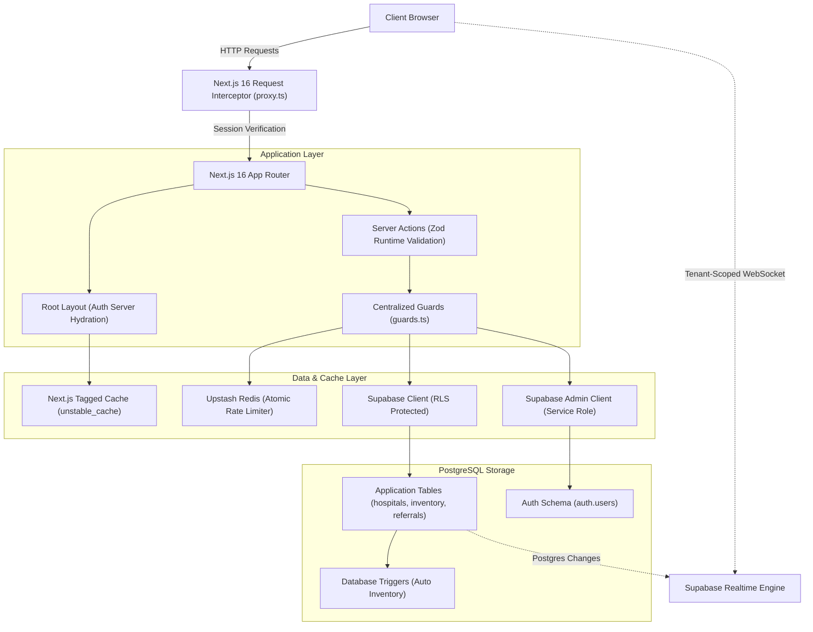
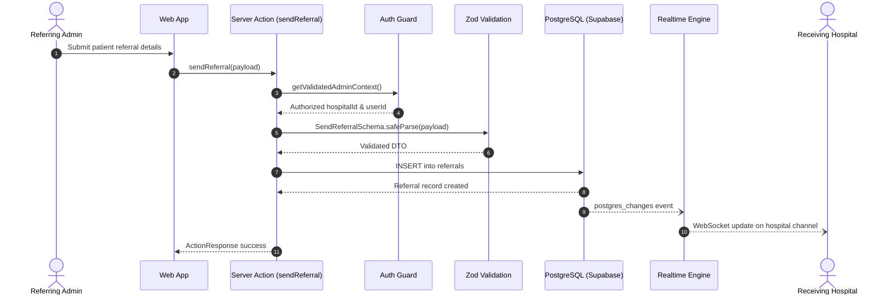

# NearH

NearH is a real-time healthcare network platform designed to coordinate hospital bed availability, ICU capacity, blood bank inventories, and inter-hospital emergency referrals.

Live Demo: [https://nearh-beta.vercel.app](https://nearh-beta.vercel.app)

---

## Overview

In emergency medical care, delays in finding specialized care or available beds can be critical. NearH provides a synchronized network across healthcare facilities:
- **Emergency Bed & ICU Tracking**: Live monitoring of available general beds, ICU units, and ventilators.
- **Blood Bank Availability**: Real-time tracking of blood groups across verified clinical centers.
- **Inter-Hospital Referrals**: Secure transfer dispatch between hospitals with status tracking and medical history.
- **Doctor Directory**: Searchable directory matching specialists by hospital location and clinical status.
- **Administrative Governance**: Multi-tier access control separating public patients, hospital administrators, and platform superadmins.

---

## System Architecture

NearH is built on Next.js 16 App Router, Supabase (PostgreSQL with Row Level Security), and Upstash Redis.



### Architectural Highlights

- **Edge Interception**: `proxy.ts` operates on the Node.js runtime as the request interceptor in Next.js 16, refreshing Supabase session tokens and enforcing authentication route boundaries.
- **Zero-Flicker Layout Hydration**: The root layout (`app/layout.tsx`) pre-hydrates the authenticated user session and cached profile directly from the server, eliminating client layout shifts and removing redundant `/api/auth/me` client waterfalls.
- **Multi-Tier Authorization Guards**: Centralized security guards (`lib/auth/guards.ts`) enforce role-based access control (`user`, `admin`, `superadmin`) across all server actions.
- **PostgreSQL Inner Join Filtering**: Explore queries utilize PostgREST inner joins (`doctors!inner(...)`, `hospital_services!inner(...)`) to guarantee that hospital results match active doctor specialties and services at the database level.
- **Native Tagged Caching**: Static master data (locations, specialties, services) uses Next.js `unstable_cache` with granular cache tags and automated revalidation on mutations.
- **Tenant-Scoped Realtime**: WebSockets are isolated by hospital ID (`referrals-hospital-{id}`) to prevent cross-tenant notification storms and protect patient transfer privacy.
- **Defense in Depth**: Runtime Zod validation schemas (`lib/validations/actions.ts`) sanitize all server action inputs. Hospital profile updates enforce strict field whitelisting to prevent unauthorized privilege escalation.

---

## Referral Workflow

The following sequence outlines how an emergency patient transfer is dispatched and processed between facilities:



---

## Technology Stack

| Layer | Technology | Purpose |
| :--- | :--- | :--- |
| **Framework** | Next.js 16 (App Router, Turbopack) | Server Components, Server Actions, SSR routing |
| **Frontend Library** | React 19 | UI rendering and component architecture |
| **Language** | TypeScript | End-to-end type safety |
| **Styling** | Tailwind CSS v4 | Utility-first responsive design |
| **Database** | Supabase (PostgreSQL 15+) | Relational schema, custom enums, RLS policies |
| **Authentication** | Supabase Auth API & SSR | Encrypted session cookies, role-based profiles |
| **Caching & Rate Limiting** | Upstash Redis | Pipelined atomic rate limiting, profile caching |
| **Schema Validation** | Zod | Runtime input validation on client forms and server actions |
| **Icons** | Lucide React | Consistent UI vector icons |
| **Notifications** | Sonner | Toast feedback for asynchronous operations |

---

## Project Structure

```
nearh/
├── actions/                  # Next.js Server Actions
│   ├── admin/                # Hospital admin operations (doctors, inventory, referrals, profile)
│   ├── shared/               # Shared hospital queries and explore filters
│   └── superadmin/           # Platform governance (approvals, master catalogs, dashboards)
├── app/                      # Next.js App Router
│   ├── (routes)/
│   │   ├── (general)/        # Public routes (home, explore, hospital profiles, mission)
│   │   ├── (protected)/      # Authenticated dashboards (admin, superadmin)
│   │   └── auth/             # Login, signup, password reset, waiting room
│   ├── api/                  # API endpoints (health, auth callbacks)
│   ├── layout.tsx            # Root layout with server auth pre-hydration
│   └── globals.css           # Global stylesheet and Tailwind utilities
├── components/               # React UI Components
│   ├── admin/                # Admin dashboard cards, forms, and referral clients
│   ├── general/              # Navigation bar, footer, hero, feature sections
│   ├── hospital/             # Hospital profile tabs and detail clients
│   ├── shared/               # Explore directory, doctor cards, inventory tabs
│   └── superadmin/           # Approval tables, KPI summaries, catalog forms
├── lib/                      # Core Shared Utilities
│   ├── auth/                 # Centralized authorization guards (guards.ts)
│   ├── supabase/             # Supabase clients (client, server, and service-role admin)
│   └── validations/          # Zod validation schemas (forms and action DTOs)
├── types/                    # TypeScript interfaces and generated database types
├── utils/                    # Caching mechanics and pipelined rate limiters
├── proxy.ts                  # Next.js 16 Node runtime request interceptor
```

---

## Local Setup

### Prerequisites

Ensure you have the following installed locally:
- Node.js (v18.18.0 or newer)
- npm (v9.0.0 or newer)
- A Supabase project with database migrations applied
- An Upstash Redis database (REST-based)

### 1. Clone the Repository

```bash
git clone https://github.com/MohdMusaiyab/nearH.git
cd nearH
```

### 2. Install Dependencies

```bash
npm install
```

### 3. Configure Environment Variables

Create a `.env` file in the project root:

```env
# Supabase Configuration
NEXT_PUBLIC_SUPABASE_URL=https://your-project.supabase.co
NEXT_PUBLIC_SUPABASE_ANON_KEY=your-anon-key
SUPABASE_SERVICE_ROLE_KEY=your-service-role-key

# Upstash Redis Configuration
UPSTASH_REDIS_REST_URL=https://your-upstash-redis.upstash.io
UPSTASH_REDIS_REST_TOKEN=your-upstash-redis-token

# Application URL
NEXT_PUBLIC_SITE_URL=http://localhost:3000
```

> **Note on Service Role Key**: `SUPABASE_SERVICE_ROLE_KEY` is strictly required on the server for superadmin operations (such as resolving admin registration emails and purging rejected applicant identities). It is never sent to the browser.

### 4. Run Development Server

```bash
npm run dev
```

Open [http://localhost:3000](http://localhost:3000) in your browser.

### 5. Verify Build and Types

To verify that the project compiles with zero type errors:

```bash
npx tsc --noEmit
npm run build
```

---

## Live Deployment

The application is deployed on Vercel at [https://nearh-beta.vercel.app](https://nearh-beta.vercel.app).
